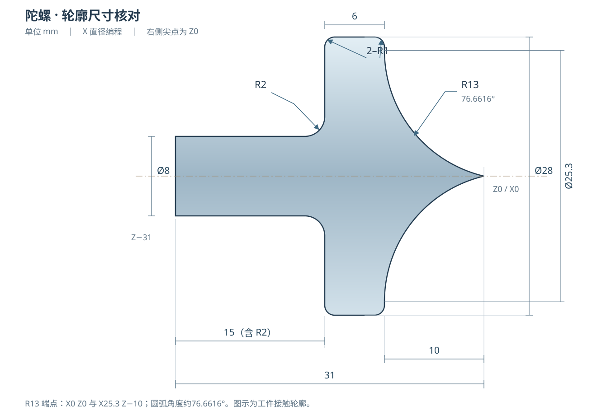

# 数控车削仿真 · Turning Lab

一个可离线运行的二维 XZ 数控车削教学工具。编写 SINUMERIK 风格的程序，检查后播放刀具运动，观察圆柱毛坯的切削结果。

使用原生 HTML、CSS、JavaScript，无构建步骤、无外部运行依赖。界面与刀具库由全部实验共用，陀螺只是其中一个工件实验。

## 快速运行

1. 下载并解压本仓库，或执行：

   ```sh
   git clone https://github.com/bllfs/-.git turning-lab
   ```

2. 在浏览器打开根目录的 `index.html`。Windows 也可双击 `打开仿真.cmd`。
3. 选择实验与示例，点击“检查程序”，通过后播放、逐段执行或查看成品。
4. 可直接编辑、导入及导出 `.txt` 程序；草稿与设置保存在本机浏览器中。

直接打开 `陀螺/index.html` 或双击 `陀螺/打开陀螺演示.cmd`，可进入陀螺实验。

## 支持内容

- `G00` 快移、`G01` 直线、`G02/G03` 的 `CR` 圆弧、`G33` 等直径外螺纹。
- `G18/G90/G710/DIAMON`：XZ 平面、绝对坐标、公制、X 直径编程。
- `G95` 每转进给、`G94` 每分钟进给、`G97` 固定主轴转速。
- `T1–T4 D1`、`M03/M04/M05/M30/M02`，以及可选的 `N` 程序段号。
- 有界的 R 参数算术和 `REPEAT` 子集，支持 `SQRT/ABS/MAXVAL/MINVAL/TRUNC`。
- 刀片、刀颈、刀杆与材料/卡盘的二维干涉检查，G00 穿料、行程、进给、刀具用途及工件目标过切检查。错误会禁止播放并定位原程序行。

这是明确限定的教学指令子集。未支持的指令会报错；不能直接替代具体 SINUMERIK 控制器的完整解释器或实机验证。

## 刀具与陀螺实验

| 刀具 | 用途 | 转速 r/min | 进给 mm/r | 本项目工艺参数 |
| --- | --- | --- | --- | --- |
| T1 | 外圆粗车 | 500–600 | ≤0.3 | 2ap≤5 mm |
| T4 | 外圆精车 | 600–800 | ≤0.1 | 2ap≤0.5 mm |
| T2 | 切槽、侧刃修形与切断 | 350–450 | ≤0.08 | 直径精加工余量 0.2 mm |
| T3 | G33 螺纹 | 默认 350 | 按 K×S 同步 | 默认单刀直径切深≤0.6 mm |

T2 为 3 mm 平底刀，以最左刃尖为基准，刃宽沿 +Z 延伸。0.2 mm 表示精加工余量，粗槽直接进到目标 X 后退出。

陀螺毛坯直径 30 mm，成品总长 31 mm、最大直径 28 mm、柄径 8 mm。R13 保留 X25.3/Z-10 端点，弧角约 76.661556°。最左柄端是 Ø8 平直端面，无倒角。T1/T4 外圆接触延至 Z-16.2，与后肩 R1 加工范围重叠以清除交接余料。

T2 工序为：六次直进粗槽 → 粗修留量 → 一次连续精修 → 直接切断。



- [完整陀螺程序](陀螺/程序/陀螺_完整程序.txt)
- [轮廓坐标与工艺](陀螺/轮廓坐标与工艺.txt)
- [刀具参数](主体项目/刀具/刀具参数.txt)

## 项目结构

```text
主体项目/
  index.html · app.js · style.css   共享界面
  核心/                            程序解析、流程与材料仿真
  刀具/                            唯一刀具模型与工艺参数
  实验/                            基础圆柱实验
  测试/                            自动检查
陀螺/                              工件定义、一份完整程序、SVG图纸与工艺
示例程序/                          五个基础练习.txt
```

完整运行与实验扩展说明见 [使用说明.txt](使用说明.txt)，维护约定见 [AGENTS.md](AGENTS.md)。

## 验证

安装 Node.js 后，在仓库根目录运行：

```sh
node --test 主体项目/测试/verify.cjs
```

当前有 28 项自动检查，涵盖指令、刀具、干涉、实验隔离、材料与动画一致性、Ø8 平直柄端及外圆交接残料。浏览器验证记录见 [验证记录.txt](验证记录.txt)。

二维模型不模拟三维刀座、切削载荷、振动、主轴真实动态或工件承接；实机加工需根据实际刀具、刀补和装夹核对程序。

## 许可证

[MIT](LICENSE)，Copyright © 2026 bllfs。
